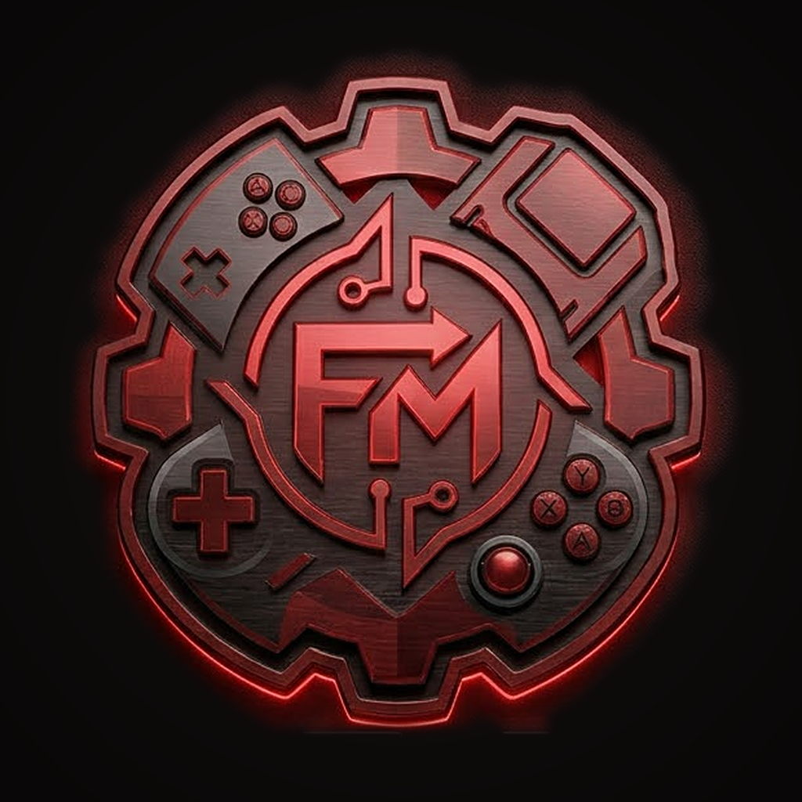

<p align="center"></p>

# FMLAB Emulator

Emulatore per iPhone (IPA) con **la TV come schermo vero** e **Controller 2 dal Wi-Fi**, più **FMLAB Controller**
per Android (APK), che fa da Controller 2 per FMLAB Emulator.

**Stato: 0.6.1.**
Nessun gioco o BIOS è incluso o scaricato dall'app: usa solo le tue copie.

## Installare

| | |
|---|---|
| **iPhone** | LiveContainer (o SideStore, AltStore) → **+** → *Installa dall'URL* → `https://github.com/cipherdesk007-max/emulator-ios-andorid/releases/download/ultima/FMLAB-Emulator.ipa` |
| **Android** | Apri [FMLAB-Controller.apk](https://github.com/cipherdesk007-max/emulator-ios-andorid/releases/download/ultima/FMLAB-Controller.apk) dal telefono e consenti l'installazione da questa fonte |

Le versioni nuove escono da sole in [Releases](https://github.com/cipherdesk007-max/emulator-ios-andorid/releases):
`ultima` è sempre l'ultima, e ogni versione ha anche la sua (`v0.1.0`, …).

## Cosa fa

**Console**: NES, Game Boy / Color, Game Boy Advance, Super Nintendo, PlayStation, PSP, Nintendo DS. Il motore
(core libretro, senza JIT) è lo stesso di FMLAB Linux 0.13.1 e i core arrivano dal progetto
[fmlab-retro](https://github.com/cipherdesk007-max/fmlab-retro). Valgono anche qui:
- i salvataggi sicuri, con le copie automatiche;
- *Riprendi*;
- le copertine;
- i giochi in .zip, .7z e .rar;
- la grafica migliorata;
- la modifica dei tasti.

**TV**: accendi *Duplica schermo* dal Centro di Controllo, oppure collega un cavo USB-C/HDMI.
- La TV mostra solo il gioco, a tutto schermo, e l'iPhone diventa il controller (con il tasto *Impostazioni*).
- Senza un gioco aperto, la TV mostra il logo.
- È fatta come il desktop di FMLAB Linux: una sola finestra nella scena della TV (`ios/FMLABEmulator/TV`). Su
  iOS 27 l'app chiede lo schermo separato all'avvio.

**Gioca in compagnia (stesso Wi-Fi)**: l'amico apre *Controller 2* (FMLAB Emulator su iPhone, oppure FMLAB
Controller su Android) e tocca il telefono che ha il gioco.
- Diventa il giocatore 2, e fino a 4 persone possono collegarsi.
- Va bene per i giochi fatti per due controller sulla stessa console (es. SNES, PS1, NES).
- L'immagine è una sola: la TV, oppure il telefono con il gioco.
- Non è il gioco in rete tra due console (es. il wireless del DS): quello richiederebbe due emulatori sincronizzati.
- Protocollo: [docs/PROTOCOLLO.md](docs/PROTOCOLLO.md).

## Struttura

```
ios/FMLABEmulator/
  Motore/       emulatore (libretro, salvataggi, schermo di gioco, tasti)
  TV/           scena della TV e registrazione dello schermo esterno di iOS 27
  Rete/         host Wi-Fi (giocatori 2–4) e cliente Controller 2
  Controller/   schermata Controller 2 su iPhone
  App/          avvio, schede, impostazioni
android/        FMLAB Controller (Kotlin, nessuna libreria esterna)
.github/workflows/  ios.yml → IPA, android.yml → APK
```

Le build si fanno su GitHub, gratis. L'IPA si compila sui Mac con XcodeGen e xcodebuild, senza firma: la mette
chi installa. L'APK si compila su Linux con Gradle, con la firma fissa descritta in
[android/firma/LEGGIMI.md](android/firma/LEGGIMI.md).

## Come si verifica

- **TV**: con *Duplica schermo* attivo, apri un gioco. Sulla TV ci dev'essere solo il gioco e sul telefono solo
  i tasti. Poi menu del gioco › *Copia rapporto*: deve dire `Schermo esterno: Collegato · …` e `usato: sì`; su
  iOS 27 anche `iOS 27: registrato`.
- **Controller 2**: con un secondo telefono sullo stesso Wi-Fi, apri *Controller 2* e tocca il telefono con il
  gioco. Sul telefono del gioco (e sulla TV) deve comparire "Giocatore 2 collegato". Nel menu di un gioco SNES
  a due giocatori, il secondo controller muove il giocatore 2.
- **Senza telefoni**: c'è un finto controller in Python in [docs/PROTOCOLLO.md](docs/PROTOCOLLO.md).
